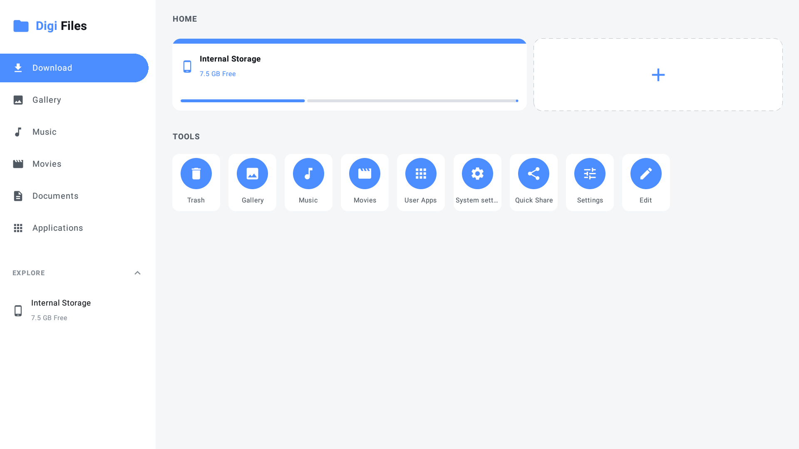
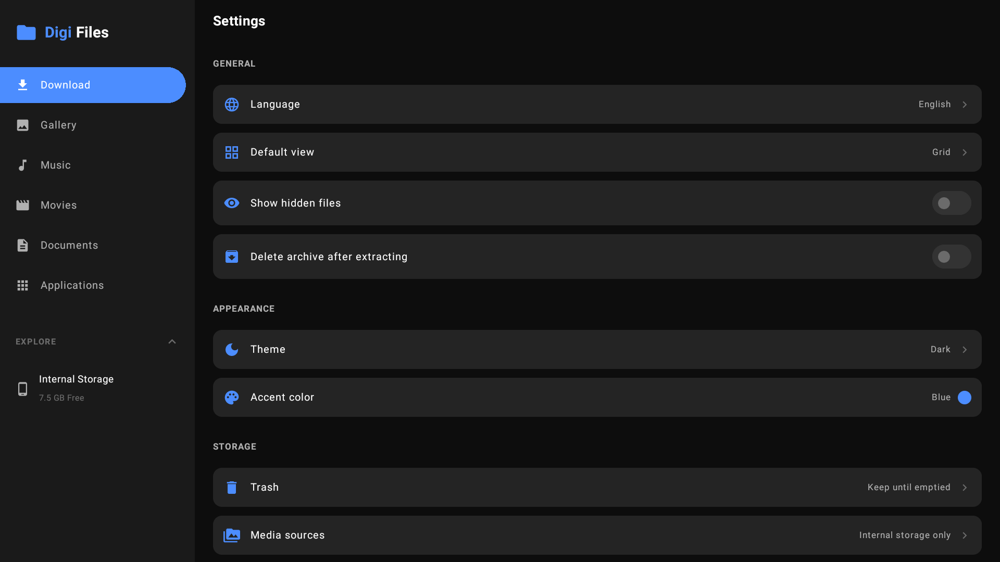
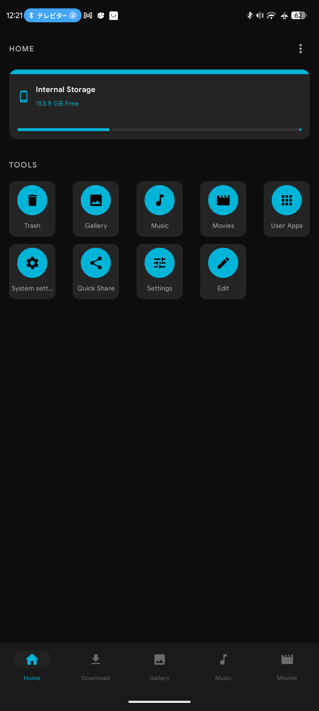
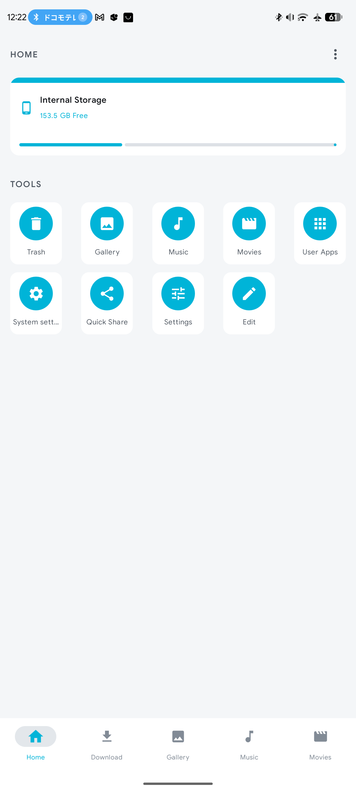
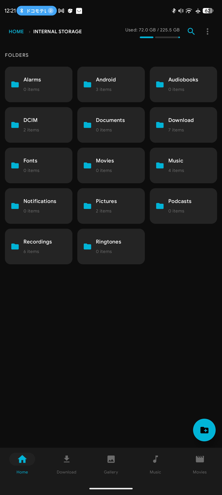
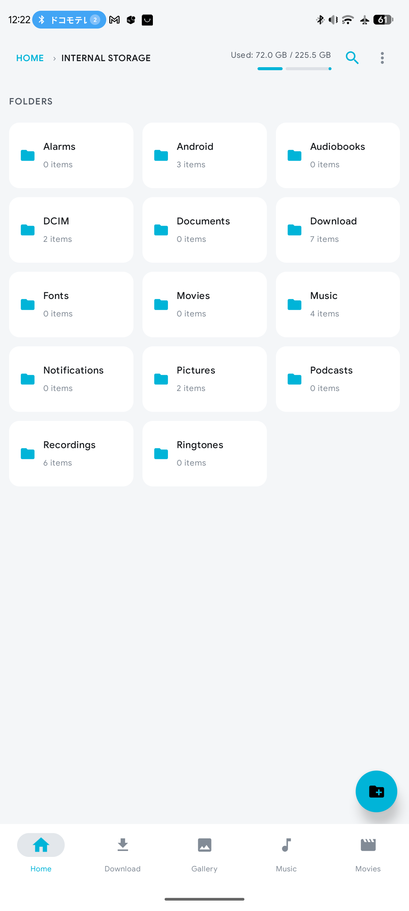
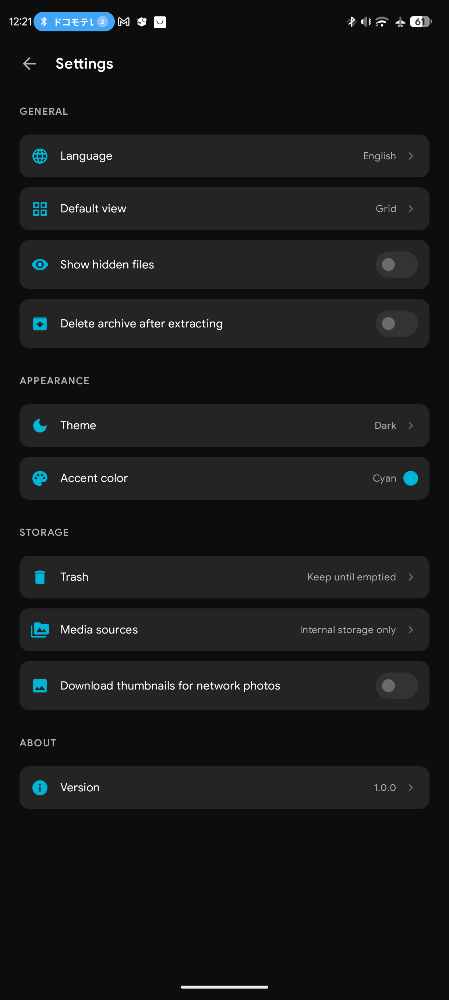
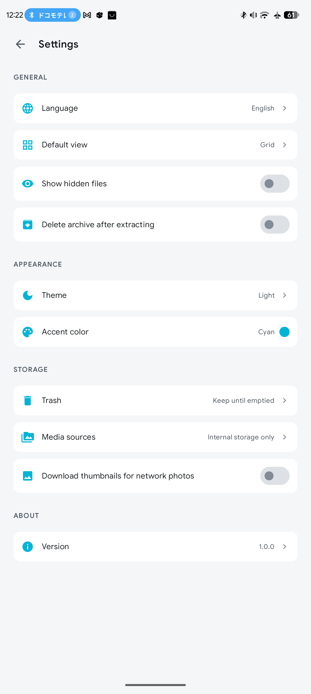

# Digi Files


<div align="center">
  
  
</div>
<br />
<!-- Baris Kedua: 6 Gambar Horizontal -->
<div align="center">
  
  
  
  
  
  
</div>

Digi Files is an Android file manager written in Kotlin with Jetpack Compose. Its UI adapts to phones, tablets and Android TV (D-pad navigation and focus styling are part of the UI code). Besides browsing local storage it works with archives, network (SMB) shares, photos, music and video.

---

## Table of contents

- [Features](#features)
- [Technology stack](#technology-stack)
- [Requirements](#requirements)
- [Build from source](#build-from-source)
- [Project structure](#project-structure)
- [Permissions and data handling](#permissions-and-data-handling)
- [Known limitations](#known-limitations)
- [Contributing](#contributing)
- [License](#license)
- [Acknowledgments](#acknowledgments)

---
## Features

### Browsing and file operations

- **Home screen** with storage volumes (internal storage plus detected removable drives and saved network servers) and a grid of tools: Trash, Gallery, Music, Movies, User Apps, System settings, Quick Share, Settings. The tool grid can be customized (Edit).
- **File browser** with grid or list view, a "show hidden files" toggle, search within the current folder, and multi-select (including select all / select between).
- **Copy, move, paste, rename, create folder, share, properties.** Copy and move run as queued background tasks in a foreground service with progress, cancel and undo. Name conflicts offer Keep both / Replace / Skip; replaced items go to Trash.
- **Trash.** Deleting can move items to Trash, which renames them to `.trashed-<seconds>-<name>` in their original folder (see [`FileOps.kt`](app/src/main/java/com/appsventory/digiapps/nemo/util/FileOps.kt)), or delete permanently. Items can be restored, and Trash can be emptied manually or automatically after a configurable number of days.
- **Open / install.** APK files are handed to Android's package installer (the app asks you to allow installs from this app first). Images, video, audio, archives, PDF and plain text open in Digi Files when supported; other types use the system "open with" chooser.
- **Eject** for removable volumes, where the device allows it; otherwise the app opens system settings.
- **Create folder** dialog always starts with an empty name field after create, cancel, or dismiss (no stale text).

### Open with Digi Files (external intents)

Digi Files can be chosen from a browser, download manager, or system file manager to open a supported file directly.

- **VIEW** intent filters are limited to formats the app can actually handle: `image/*`, `video/*`, `audio/*`, common archive MIME types, `application/pdf`, and `text/*`. There is **no** catch-all `*/*` VIEW filter, so Digi Files does not appear for unsupported types (e.g. Office documents).
- **GET_CONTENT / PICK / OPEN_DOCUMENT** still accept `*/*` so other apps can use Digi Files as a **file picker**.
- Incoming `content://` and `file://` URIs are resolved at runtime ([`ExternalFileOpen.kt`](app/src/main/java/com/appsventory/digiapps/nemo/util/ExternalFileOpen.kt)); archives without a local path may be copied to a temporary cache file.
- **Routing:** images → in-app image viewer; video → Media3 player; audio → music player service; archives → archive browser; PDF → platform `PdfRenderer` viewer; text → streaming text viewer.
- **Back after an external open:** on a cold start from VIEW/SEND, closing the preview finishes the activity so Android returns to the calling app. If Digi Files was already running, only the preview closes and the existing session continues.
- Warm starts use `singleTop` + `onNewIntent` so a second external file can open without stacking duplicate main activities.

### Archives

Format support, taken from [`Archives.kt`](app/src/main/java/com/appsventory/digiapps/nemo/util/Archives.kt):

| Format | Open / extract | Create |
|---|---|---|
| ZIP | yes | yes (optional AES-256 password) |
| 7z | yes | yes (optional AES-256 password) |
| TAR, TAR.GZ | yes | yes |
| TAR.BZ2, TAR.XZ, GZ, BZ2, XZ | yes | no |
| RAR | RAR4 only | no |

- View an archive's contents, extract everything, extract to a named folder, or extract selected entries.
- Password-protected archives prompt for a password.
- Compression level choice (Store / Fast / Normal / Maximum) where the format supports it.
- Setting: delete the archive (to Trash) after extracting.

### Network (SMB)

- Add a network location by server address, with anonymous/guest or user name, password and optional domain.
- Scan the local network for SMB servers (mDNS `_smb._tcp`), and add shared folders by name for servers that do not list their shares.
- Browse and copy files from shares; opening a file downloads it to the app cache first.
- Network photo thumbnails are optional and off by default.
- The SMB client is [jcifs-ng](https://github.com/AgNO3/jcifs-ng), configured for SMB1 through SMB 3.1.1 negotiation (`SmbClient.kt`).

### Documents

- **PDF viewer** using Android's built-in `PdfRenderer` (no third-party PDF library): vertical page list, on-demand page bitmaps, pinch zoom, and clear errors for inaccessible, empty, or unreadable files. Works with `content://` URIs via `ParcelFileDescriptor`.
- **Text viewer** for plain text and common text-like extensions (`.txt`, `.md`, `.log`, `.json`, …): UTF-8 with BOM / UTF-16 detection, 2 MiB read limit with a truncation notice, monospace dark-theme layout.

### Media

- **Gallery:** Photos, Videos and Albums tabs. The photo viewer supports swiping (or D-pad left/right), pinch and double-tap zoom, share, and delete (to Trash or permanently).
- **Music:** Songs, Albums and Artists tabs. Playback uses Android's `MediaPlayer` and is kept alive by a foreground service with a media notification and media-session controls.
- **Movies / video player:** Media3 ExoPlayer with vertical paging between videos, playback speed, audio-track selection and an "Auto Next" option.
- Media is read from internal storage plus any removable drives or saved network servers you enable under *Settings → Media sources*.

### Other screens

- **User Apps:** lists installed user and system apps.
- **Settings:** default view (grid/list), show hidden files, delete archive after extracting, theme (Dark / Light / Auto), accent color (Cyan, Blue, Green, Orange, Pink, Purple, Red, or System wallpaper), automatic Trash emptying, media sources, SMB thumbnails, and the app version. The *Language* row is display-only: the app currently ships English strings only.
- **Check for Updates** (*Settings → Version*): queries the latest release from the GitHub Releases API for the repository configured in `ReleaseConfig`, compares versions, shows the formatted release notes, and can download an APK asset with Android's `DownloadManager`. A downloaded APK is verified (file exists, matches the published size, parses as a package) before the button changes to **Install Now**, which opens the system package installer. If a release has several APKs you choose one in a dialog; nothing is downloaded until you confirm.

## Technology stack

Versions are taken from [`gradle/libs.versions.toml`](gradle/libs.versions.toml), [`app/build.gradle.kts`](app/build.gradle.kts) and the Gradle wrapper files.

| Area | Details |
|---|---|
| Language | Kotlin 2.2.10 (Java 11 source/target compatibility) |
| UI | Jetpack Compose (BOM 2026.02.01), Material 3, Compose foundation 1.12.1, extended Material icons |
| Build | Gradle 9.6.0 (wrapper), Android Gradle Plugin 9.4.0, Kotlin Compose compiler plugin |
| Android SDK | `compileSdk` 37, `targetSdk` 37, `minSdk` 24 |
| Media | AndroidX Media3 ExoPlayer / UI / Common 1.5.1; Coil 2.7.0 and coil-video for thumbnails |
| Archives | Apache Commons Compress 1.27.1, XZ for Java 1.10, zip4j 2.11.5, junrar 7.5.5, plus a hand-written TAR codec ([`TarCodec.kt`](app/src/main/java/com/appsventory/digiapps/nemo/util/TarCodec.kt)) |
| Network | jcifs-ng 2.1.10 |
| Tests | JUnit 4.13.2 (unit), AndroidX test / Espresso / Compose UI test (instrumented) |

## Requirements

- **Device:** Android 7.0 (API 24) or newer, per `minSdk = 24`. Phones, tablets and Android TV are targeted; the manifest declares both launcher and Leanback launcher entries and marks touchscreen and Leanback features as not required.
- **Storage access:** the app asks for "All files access" (`MANAGE_EXTERNAL_STORAGE`) on first run to browse and manage files.
- **To build:** Android Studio with a version that supports AGP 9.4.0, the Android SDK platform for API 37, and a JDK. The Gradle daemon is configured for a Java 25 toolchain (`gradle/gradle-daemon-jvm.properties`, resolved through the Foojay toolchain resolver plugin in `settings.gradle.kts`), so Gradle needs network access to provision it unless one is installed.

## Build from source

The Gradle root contains a single module, `:app` (root project name `Digi Files`). Application ID and namespace: `com.appsventory.digiapps.nemo`. 

```bash
git clone https://github.com/Appsventory/Digi-Files.git
cd Digi-Files

# Debug build
./gradlew :app:assembleDebug

# Unit tests
./gradlew :app:testDebugUnitTest

# Release build
./gradlew :app:assembleRelease
```

Notes:

- On Windows use `gradlew.bat`.
- The APK is written under `app/build/outputs/apk/`.
- You can also open the Gradle root in Android Studio and run the `app` configuration.

### Installation

No prebuilt release is referenced from this repository. Install by building from source and installing the debug APK (for example with `adb install app/build/outputs/apk/debug/app-debug.apk`), or by using the file manager of a device to open the APK (Android will ask you to allow installs from that app).

## Project structure

```
.
├── build.gradle.kts            # root build file (plugin aliases)
├── settings.gradle.kts         # repositories, toolchain resolver, includes :app
├── gradle.properties
├── gradle/
│   ├── libs.versions.toml      # version catalog
│   └── wrapper/                # Gradle wrapper (9.6.0)
└── app/
    ├── build.gradle.kts        # module config, SDK levels, dependencies, update-source constants
    └── src/
        ├── main/
        │   ├── AndroidManifest.xml
        │   ├── java/com/appsventory/digiapps/nemo/
        │   │   ├── MainActivity.kt, AppsActivity.kt, SettingsActivity.kt,
        │   │   │   UpdateActivity.kt, VideoPlayerActivity.kt, MediaActivities.kt
        │   │   ├── MusicService.kt, FileTaskService.kt   # foreground services
        │   │   ├── ui/        # Compose screens and components (file browser, home, gallery,
        │   │   │              #   music, settings, update screen, dialogs, focus styling)
        │   │   │   └── theme/ # palette, typography, theme
        │   │   ├── util/      # file operations, archives, storage/volume handling, tasks,
        │   │   │              #   music player, settings, notifications
        │   │   ├── smb/       # SMB client and saved connections
        │   │   ├── update/    # GitHub release check, release-notes Markdown, downloader
        │   │   └── data/      # data classes
        │   └── res/           # strings, colors, dimens, themes, launcher icons, FileProvider paths
        ├── test/              # JUnit unit tests and archive fixtures
        └── androidTest/       # instrumented test template
```

UI colors, dimensions and strings are defined in resource files ([`colors.xml`](app/src/main/res/values/colors.xml), [`dimens.xml`](app/src/main/res/values/dimens.xml), [`strings.xml`](app/src/main/res/values/strings.xml)).

## Permissions and data handling

Declared in [`AndroidManifest.xml`](app/src/main/AndroidManifest.xml):

| Permission | Used for |
|---|---|
| `MANAGE_EXTERNAL_STORAGE`, `READ_EXTERNAL_STORAGE`, `WRITE_EXTERNAL_STORAGE` (API ≤ 28) | Browsing and managing files |
| `READ_MEDIA_IMAGES`, `READ_MEDIA_VIDEO`, `READ_MEDIA_AUDIO` | Gallery, Music and Movies screens (MediaStore) |
| `INTERNET`, `ACCESS_NETWORK_STATE` | SMB access, update check, downloading updates |
| `ACCESS_WIFI_STATE`, `CHANGE_WIFI_MULTICAST_STATE`, `NEARBY_WIFI_DEVICES` | Finding SMB servers on the local network; `NEARBY_WIFI_DEVICES` is requested only when you tap "Scan for servers" and is flagged `neverForLocation` |
| `FOREGROUND_SERVICE` (+ `_MEDIA_PLAYBACK`, `_DATA_SYNC`), `POST_NOTIFICATIONS`, `WAKE_LOCK` | Copy/move/archive tasks and music playback |
| `REQUEST_INSTALL_PACKAGES` | Installing APK files you open or download |
| `QUERY_ALL_PACKAGES` | Listing installed apps in User Apps |
| `MOUNT_UNMOUNT_FILESYSTEMS` | Ejecting drives; only granted to privileged apps, other devices fall back to system settings |

Data handling as implemented:

- **Local files** are accessed in place; the app does not upload them. Network access in the code is for SMB servers you configure and for the GitHub update check/download.
- **SMB connections** (server, user name, domain, shares) are stored in the app's private `SharedPreferences`; the **password is encrypted with AES-GCM using a non-exportable Android Keystore key** (`SecretBox` in `SmbConnection.kt`).
- **Cache:** files opened from SMB shares and archive entries opened from the viewer are copied into the app's cache directory (`cacheDir/smb`, `cacheDir/archive_view`).
- **Update downloads** go to the app's own external files directory (`.../files/Download/updates/<release>/<file>`) and a small record of each download is kept in private preferences.
- **Settings** (theme, view mode, Trash retention, etc.) are stored locally in `SharedPreferences`.
- The update check calls the public GitHub REST API without authentication. No analytics or crash-reporting libraries appear in the dependencies.
- `android:allowBackup="true"` is set in the manifest; the repository includes backup and data-extraction rule files under `res/xml/`.

This is a description of the code, not a security audit.

## Known limitations

- RAR5 archives cannot be opened (junrar supports RAR4); RAR archives cannot be created. A unit test documents the RAR5 behavior.
- TAR.BZ2, TAR.XZ, GZ, BZ2 and XZ archives can be extracted but not created. TAR has no password protection.
- The app UI is English only; the Language setting is informational.
- The in-app update flow lists only APK assets (AAB and source archives are excluded) and does not itself check APK signatures beyond Android's own installer checks.
- Video thumbnails for SMB files are not generated (the setting notes that grabbing a frame would require downloading the whole file).
- `PlaceholderActivity` / `PlaceholderScreen` are legacy names in the code; those screens display real Gallery, Music and Movies content.
- No continuous integration configuration, screenshots or release artifacts are included in this repository.
- Encrypted PDFs and some malformed PDFs cannot be rendered by `PdfRenderer`; the viewer shows an error instead.
- Very large text files are only shown up to the first 2 MiB.
- Opening a large archive from a `content://` URI may require a temporary copy into the app cache.
- Downloads that report only `application/octet-stream` without a matching extension may not offer Digi Files in the system chooser (by design; VIEW filters are format-specific).

## Contributing

The repository does not define contribution rules. A reasonable workflow:

1. Fork the repository and create a branch for your change.
2. Keep UI strings in `strings.xml` and colors in `colors.xml`, as the existing code does.
4. Open a pull request describing what changed and how you tested it, including the device type (phone, tablet or TV) when the change affects UI or focus behavior.

## License

No `LICENSE` file was found in this repository, so no license is granted here. Until the owner adds one, all rights are reserved by default.

## Acknowledgments

Third-party libraries actually used (see [`app/build.gradle.kts`](app/build.gradle.kts)): AndroidX Jetpack Compose and Media3, Coil, Apache Commons Compress, XZ for Java, zip4j, junrar and jcifs-ng. Each is distributed under its own license.

---

**Made with AI [♥] by ~~Mulya Saputra~~ & ICK Network Team**